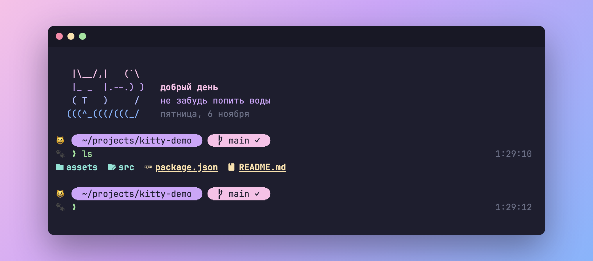
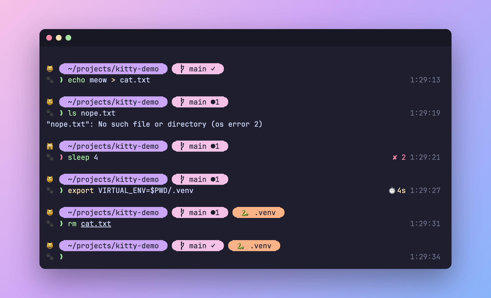
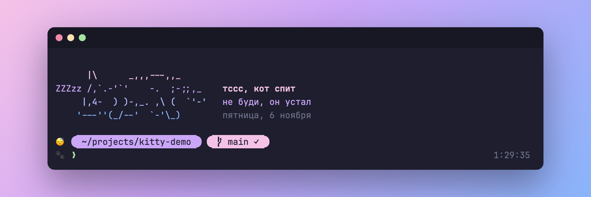

# kitty-zsh-theme

A cozy Oh My Zsh theme with pastel Catppuccin pills and a cat that reacts to what you do.

[Русская версия](README.ru.md)



## Features

- **Pill prompt:** rounded segments for the path, git and Python venv
- **Cat with moods:** the face in the prompt changes with your shell's state
- **Git at a glance:** branch, changed files, commits ahead and behind
- **Command timer:** shows up when a command takes 3 seconds or more
- **Greeting:** a gradient ASCII cat that says hello by time of day and sleeps at night

## Cat moods

| Cat | Meaning |
|---|---|
| 😺 | All good |
| 😼 | Uncommitted changes in the repo |
| 🙀 | The last command failed |
| 😴 | It's between midnight and 6 AM |



At night the greeting cat goes to sleep too:



## Requirements

- [Oh My Zsh](https://ohmyz.sh)
- A [Nerd Font](https://www.nerdfonts.com), such as JetBrainsMono Nerd Font
- A terminal with 24-bit color, such as [Ghostty](https://ghostty.org)

On macOS you can get the font and terminal with Homebrew:

```sh
brew install --cask ghostty font-jetbrains-mono-nerd-font
```

## Install

```sh
git clone https://github.com/KernelEditor/kitty-zsh-theme.git
cd kitty-zsh-theme
./install.sh --ghostty
```

The script copies the theme and greeting into Oh My Zsh, downloads the two plugins, backs up your `.zshrc` and sets `ZSH_THEME="meow"`. Leave out `--ghostty` if you don't want the Ghostty config. An existing Ghostty config is never overwritten: the new one is saved next to it as `config.meow`.

Then enable the plugins in `.zshrc` and open a new terminal:

```sh
plugins=(git zsh-autosuggestions zsh-syntax-highlighting)
```

## Customize

- **Greeting phrases:** edit the `phrases` lists in `meow-greeting.zsh`. They are in Russian by default.
- **Cat faces and colors:** edit `meow.zsh-theme`.
- **Turn off the greeting:** add `export MEOW_QUIET=1` near the top of `.zshrc`.
- **Preview another time of day:** run `MEOW_HOUR=3 exec zsh`.

In macOS Terminal.app the pills are square and have no icons, because it has no Nerd Font set up by default and no 24-bit color.

## Uninstall

Set `ZSH_THEME` back to your old theme, then delete the two files:

```sh
rm ~/.oh-my-zsh/custom/themes/meow.zsh-theme ~/.oh-my-zsh/custom/meow-greeting.zsh
```

## Credits

- Colors: [Catppuccin](https://github.com/catppuccin/catppuccin) Mocha
- ASCII cats: traditional ASCII art. The sleeping cat is commonly attributed to Felix Lee. If you know who drew the sitting cat, please open an issue.

## License

[MIT](LICENSE), except for the ASCII cats, which are not covered by it.
