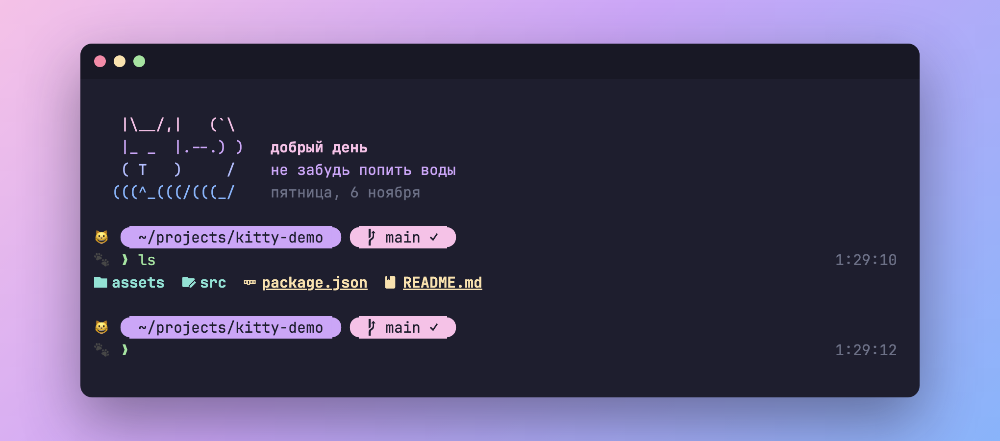
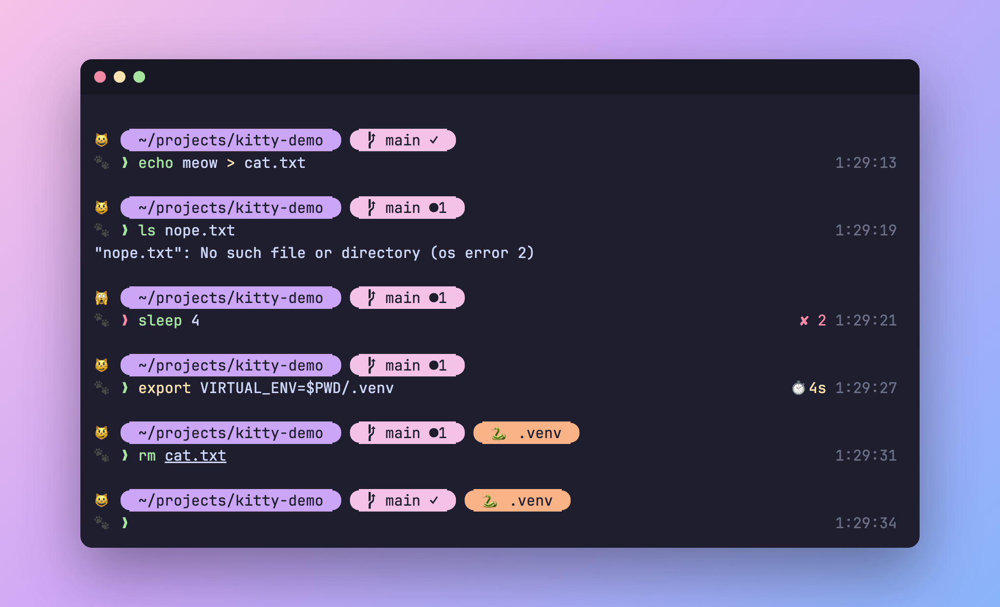
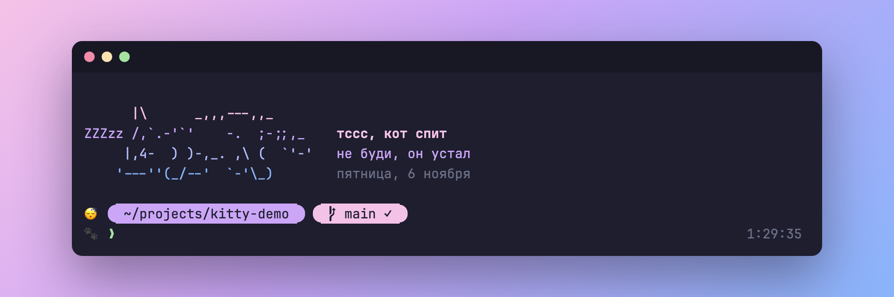

# kitty-zsh-theme

Уютная тема для Oh My Zsh с пастельными таблетками Catppuccin и котом, который реагирует на то, что ты делаешь.

[English version](README.md)



## Что умеет

- **Таблетки в промпте:** закруглённые блоки для пути, git и Python venv
- **Кот с настроением:** мордочка в промпте зависит от состояния шелла
- **Git с первого взгляда:** ветка, изменённые файлы, коммиты впереди и позади сервера
- **Таймер команд:** появляется, если команда шла 3 секунды или дольше
- **Приветствие:** ASCII-кот с цветовым переливом здоровается по времени суток, а ночью спит

## Настроения кота

| Кот | Что значит |
|---|---|
| 😺 | Всё хорошо |
| 😼 | В репозитории есть незакоммиченные изменения |
| 🙀 | Последняя команда упала |
| 😴 | Сейчас с полуночи до 6 утра |



Ночью кот из приветствия тоже засыпает:



## Что понадобится

- [Oh My Zsh](https://ohmyz.sh)
- [Nerd Font](https://www.nerdfonts.com), например JetBrainsMono Nerd Font
- Терминал с 24-битным цветом, например [Ghostty](https://ghostty.org)

На macOS шрифт и терминал ставятся через Homebrew:

```sh
brew install --cask ghostty font-jetbrains-mono-nerd-font
```

## Установка

```sh
git clone https://github.com/KernelEditor/kitty-zsh-theme.git
cd kitty-zsh-theme
./install.sh --ghostty
```

Скрипт скопирует тему и приветствие в Oh My Zsh, скачает два плагина, сделает бэкап `.zshrc` и выставит `ZSH_THEME="meow"`. Если конфиг Ghostty не нужен, убери `--ghostty`. Существующий конфиг Ghostty не перезаписывается: новый ляжет рядом как `config.meow`.

Потом включи плагины в `.zshrc` и открой новый терминал:

```sh
plugins=(git zsh-autosuggestions zsh-syntax-highlighting)
```

## Настройка

- **Фразы приветствия:** списки `phrases` в `meow-greeting.zsh`.
- **Мордочки и цвета:** `meow.zsh-theme`.
- **Отключить приветствие:** добавь `export MEOW_QUIET=1` в начало `.zshrc`.
- **Посмотреть другое время суток:** `MEOW_HOUR=3 exec zsh`.

В Terminal.app на macOS таблетки будут квадратными и без иконок: там по умолчанию нет Nerd Font и 24-битного цвета.

## Удаление

Верни в `ZSH_THEME` старую тему и удали два файла:

```sh
rm ~/.oh-my-zsh/custom/themes/meow.zsh-theme ~/.oh-my-zsh/custom/meow-greeting.zsh
```

## Благодарности

- Цвета: [Catppuccin](https://github.com/catppuccin/catppuccin) Mocha
- ASCII-коты: традиционный ASCII-арт. Спящего кота обычно приписывают Felix Lee. Если знаешь автора сидящего кота, открой issue.

## Лицензия

[MIT](LICENSE), кроме ASCII-котов: на них лицензия не распространяется.
